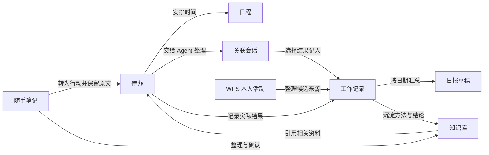

# TAgent 个人工作台：生活、工作、知识与灵感

日期：2026-10-12。根据用户要求，将上一轮「我的工作」扩展为「工作台」。本文包含整体设计与首个本地可用版本的实施状态；后续规划不等于已交付功能。

## 首版实施状态

根据「模块过多、不知道怎么用」和个人管理需求，主导航为「今天、收集、日程、回顾」。默认记录随笔、生活安排、知识资料和灵感，工作进展由用户明确标记。使用路径是「先记下 → 按需交给 Agent 整理 → 回到工作台查看和使用」。待办、日程在今天可直接操作，待办完整列表、工作记录、知识库与自动化放在「更多」中，标签、项目和日期均为可选项。

已在 TAgent 独立实现，无需部署其他项目或连接 flomo：

- 左侧「工作台」入口；今天、收集、日程、回顾四个主入口，以及待办、本地日程、工作记录视图。
- 无标题 Markdown 笔记、草稿暂存、项目与标签、发生日期、时间线、关键词/标签/日期筛选、置顶、归档、回收站与恢复。
- 笔记转待办保留原文及来源 ID，重复转换复用已有待办；待办可编辑计划日期、可选时间、项目和完成状态。
- 本地日程支持周/月日历、跨日时间段、新增/编辑/删除、待办关联和编辑版本检查。设置日期的待办直接进入日历，时间是计划时点；关联日程是独立时间段，不复制或自动完成待办。自动任务只展示现有调度器确定的下次触发（全部项目范围），不创建额外调度。窄窗口按所选日显示时间轴。当前仍没有提醒和拖拽排期。
- 新建待办默认「个人安排」，可选「工作事项」。工作记录与日报只纳入工作进展和完成的工作事项；旧数据未标记用途的待办保留历史汇总行为。日报按日期/项目汇总为可编辑 Markdown 草稿，可定稿、保留旧版本、核对来源快照与复制导出。
- 「记下」只保存原文；「保存并整理」提供链接提炼、待办/日程整理、随笔/灵感整理。先可靠保存原文，再把含来源 ID 的请求放入 Agent 会话草稿，用户发送后开始执行；已有草稿时复制请求供粘贴，避免覆盖输入。
- Pi Agent 已接入 `workbench_search`、`workbench_get`，支持按内容、类型、项目、日期查找与分页读正文；Work 模式另提供 `workbench_add`，可新增笔记、待办或本地日程，保留来源和会话，重复工具调用去重。Chat 模式只读，不支持直接保存。工具尚不支持修改、删除已有实体或完成待办。
- 链接整理复用现有内置浏览器，新增 `browser_read_text` 将实际页面正文提供给 Pi Agent。整理稿作为新记录回到「收集」，可查看原始收集；不覆盖原文。读取不到正文或需要登录时应明确报告，不能猜测视频内容。没有新增社交平台 API 或视频音频转录。
- 「回顾」保留本地规则汇总日报，并增加「让 Agent 回顾这周」：按本地周一到所选日期检索工作、生活与灵感记录。来源不足时说明缺口；计划不冒充成果。
- 知识库、自动化按钮打开原有页面与存量数据；笔记可选目标知识库并确认保存，保留来源 ID 和版本备注。知识库原有检索范围未扩大。
- 主进程原子写入、本地上一个成功版本 `.bak` 备份、整库与编辑实体的版本检查、JSON 备份导出。数据存于当前配置目录 `workbench/workbench.json`，草稿存于当前渲染环境的 localStorage。

代码入口：[界面](F:/TAgent-Desktop/apps/electron/src/renderer/components/workbench/WorkbenchPage.tsx)、[编辑器](F:/TAgent-Desktop/apps/electron/src/renderer/components/workbench/WorkbenchEditors.tsx)、[业务存储](F:/TAgent-Desktop/apps/electron/src/main/lib/workbench/workbench-store.ts)、[IPC](F:/TAgent-Desktop/apps/electron/src/main/lib/workbench/workbench-ipc.ts)、[共享契约](F:/TAgent-Desktop/packages/shared/src/types/workbench.ts)。

验证：42 项相关测试通过，涵盖存储、Agent 工具、界面流程、Pi 会话接线与正文工具；另有浏览器策略测试通过。Electron TypeScript 检查、主进程与前端构建通过。真实 Electron 使用隔离的合成资料验证了保存原文、生成会话请求、实际浏览器正文读取、通过真实工作台工具保存模拟整理稿、界面更新与回看来源；检查浅色、深色及 1440/700/375 像素宽度，无横向溢出或渲染错误。整理稿由验收脚本提供，未调用真实模型；本次不表示抖音、小红书或 WPS 在线来源已通过端到端验收。

尚待实现：社交平台稳定取文与视频/音频转录、WPS 活动自动纳入工作记录与日报、定时生成工作台日报、Agent 修改已有实体、界面跨类型统一搜索、会话跳转、语义检索、附件、备份恢复界面及完整日历提醒。新增日程仅保存在本地，不提供通知或 WPS 同步。此轮没有改动 WPS 接口、权限或登录流程。

## 产品定位

### 待办与日程联动（2026-10-12）

参考本地 Proma 的业务关系，独立实现周/月日历，未复制代码。待办新增可选 `dueTime`，旧 `dueDate` 与无时间记录保持兼容；日程新增可选 `todoId`，可编辑、解除关联或删除。修改待办项目时，关联日程跟随项目并更新版本，避免旧草稿覆盖变更。排期不会自动完成待办，也不额外创建日程。自动任务由既有调度器负责，日历只展示启用任务的实际下次触发。

本轮 48 项工作台测试通过，覆盖存储与重启读取、无效时间及关联校验、编辑冲突、Agent 建项和检索、跨月/跨年与午夜边界、重叠布局、周/月切换和界面关联操作、自动任务加载失败时本地日历仍可使用。Electron TypeScript 检查、主进程及前端构建通过；真实 Electron 使用隔离合成数据完成待办改时间、创建关联时间段、删除时间段与重新读取验证，并检查深浅主题及 1440/800/375 像素窗口，无横向溢出或渲染错误。没有调用真实模型、修改用户资料或新增提醒调度器。

### 图形概览与内容浏览（2026-10-12）

针对纯文字页面不直观的问题，已增加：今天页的快速记录与待办状态环形图、可切换周并点击日期的周日程、收集分类入口与可展开全文的卡片、回顾页近七天记录/完成待办的分组柱状图和收集构成条形图。图表支持进入相应列表或日期，分类统计每条只计一次，不虚构工作时长或效率分数。收集页默认浏览卡片，新增/编辑时展开输入，收起后草稿仍保留。

新增统计和交互验证：21 项界面及统计测试通过，覆盖项目范围、归档/回收站排除、内容分类去重、跨年日期、跨午夜日程、按本地完成日期统计、图表跳转、全文展开、输入折叠后的草稿保留，以及空白输入跟随所选日期而已有草稿保持原日期。TypeScript 检查和前端构建通过；真实 Electron 以隔离合成数据检查深浅主题与 1440/800/375 像素宽度，并验证分类图和待办状态跳转。界面沿用全局主题与控件，选择态不使用圆角加左侧强调线。

工作台是用户管理工作、生活、知识和灵感的地方：随手记录想法，安排要做的事，收集链接资料，借助 Agent 提炼和检索，再按需要沉淀知识或回顾实际进展。日报是其中一项用途。参考 flomo 的快速记录与回顾、Proma 的计划与 Agent 协作，沿用 TAgent 的知识库、WPS 证据及自动化能力，独立实现。实际使用步骤见[个人工作台使用说明](F:/TAgent-Desktop/docs/dev/PERSONAL-WORKBENCH.md)。

用户已明确：参考 flomo 及类似项目，自行开发 TAgent 的内置笔记模块，不连接 flomo 账号。flomo 登录、API、MCP 和平台同步均不在本方案范围内。

## 入口和导航

主导航新增「工作台」，主要只呈现「今天、收集、回顾」，其余操作放在「更多」。下表区分当前入口和后续能力，已有知识库、自动化保留原有数据和业务服务。

| 导航 | 用户来这里做什么 | 主要操作 |
| --- | --- | --- |
| 今天 | 记录内容、看当天安排与待处理事项 | 记下、保存并整理、新增待办或日程 |
| 收集 | 找到原始随笔、链接和 Agent 整理稿 | 搜索、标签、回看来源、转待办、入知识库 |
| 回顾 | 回顾一周或汇总当天工作 | Agent 周回顾、日报草稿、核对来源、定稿、导出 |
| 待办 | 管理要完成的事情 | 排序、截止时间、关联笔记、交给 Agent、完成 |
| 日程 | 安排具体时间，查看当天计划 | 当前为本地议程列表；周/月视图和提醒待实现 |
| 知识库 | 使用和维护可复用资料 | 沿用现有库、目录、文档、导入和检索 |
| 工作记录 | 回看当天实际做了什么 | 时间线、补记、修正、关联来源、排除无关活动 |
| 自动化 | 让 Agent 按计划处理重复工作 | 复用现有创建、编辑、启停及执行结果 |

项目在工作台视图中用于筛选，收集还提供标签和日期筛选；知识库沿用自己的检索范围，尚未实现一个界面同时搜索所有类型。正文区域只展示当前视图，详情按需打开。

## 轻笔记参考 flomo，正式知识复用现有库

flomo 官方介绍强调无压力记录、多级标签、回顾、搜索和关联笔记。这些适合轻笔记入口。[官方介绍](https://help.flomoapp.com/)、[快速记录](https://help.flomoapp.com/basic/quick-input.html)。

内置笔记默认无需标题、无需先选知识库或文件夹。写内容即可保存，项目和标签可稍后补。笔记有稳定 ID、正文、创建/修改时间及来源，可被待办、知识文档和日报引用。

现有知识库已经具备正式 Markdown 文档、目录来源、文档类型和会话检索范围，继续复用：[KnowledgeBasePage](F:/TAgent-Desktop/apps/electron/src/renderer/components/knowledge-base/KnowledgeBasePage.tsx:113)、[文档存储](F:/TAgent-Desktop/apps/electron/src/main/lib/kb/knowledge-base-document-store.ts:1)、[文档模板](F:/TAgent-Desktop/apps/electron/src/renderer/components/knowledge-base/kb-document-templates.ts:39)。

“整理入知识库”允许把一条或多条笔记整理成一篇正式文档，选择目标知识库，保留原笔记与源版本引用。生成草稿供用户编辑，不把临时想法直接当成长期事实。正式文档后续修改，不反向覆盖原始笔记。

笔记可选“工作进展”类别。工作记录视图汇总这种记录、明确完成的待办活动及用户选入的 WPS/Agent 来源；不再建立一份与笔记正文互相漂移的副本。任务完成事件只记录完成事实和时间，结果说明通过关联记录补充。

## 统一的关系，而非只有统一菜单

例子：记下“SVN 提交中文乱码” → 从这条笔记创建“定位编码问题”待办 → 安排下午的处理时段 → 在待办中启动 Agent 并引用原笔记和编码规范 → 记下“定位到转换环节，回归仍未完成” → 日报引用该进展 → 验证完成后把解决方法整理入知识库。

转成待办时保留原笔记；排期不代表已完成；会话输出结束不代表问题已解决；知识资料是背景依据，不是当天工作成果。

## 今天页面

顶部为选定日期和快捷记录输入框。主体显示当天日程、待办、工作记录摘要和日报状态，信息不足时提示补记，不强制展示统计仪表盘。

提供“待整理”区：未归类笔记、Agent 建议的行动项、WPS 候选活动可以在这里处理。用户可纳入、忽略或关联已有条目；AI 识别出的“明天测试一下”先作为行动建议，不直接创建远端日程。

WPS 采集状态显示最近成功时间、采集范围和来源缺口。连接设置仍由设置页管理。点击错误可以定位对应来源配置，不用在每个业务页面重复填写凭据。

## Agent 如何使用工作台

当前聊天可通过 `workbench_search` 查找笔记、待办、日程与日报，通过 `workbench_get` 获取正文。Work 模式可新增记录并关联原始笔记；Chat 模式只读。用户可说「找出最近关于旅行的想法」「结合这周记录回顾工作和生活」「把这条想法整理成待办」。知识库写入继续通过现有界面选择目标库确认，不因为工作台接入就自动扩大知识库权限。

所有读写通过类型明确的本地业务服务执行，界面与 Pi 工具调用同一服务。服务负责校验 ID、版本、作用域和变更事件，操作后更新对应条目，不刷新整页。

工作台 Agent 搜索支持类型、项目、日期和关键词，结果保留来源标识；当前本地工作台属于本机配置，未实现多账号分区。界面跨类型搜索、标签语义关联与知识库统一检索仍属后续规划，保留知识库现有的检索方式。

Agent 内部记忆服务继续用于上下文和行为学习，不能与用户知识文档自动互相覆盖。工作台可引用已有资料，但不把所有随手记、WPS 消息无差别变成 Agent 永久记忆。

## 类似项目调研与自研取舍

以下依据 2026-10-12 查阅的官方仓库/文档，未部署这些项目，未复制源文件或组件。借鉴建议是面向 TAgent 的设计判断，不表示这些项目已有完整工作台能力。

| 项目 | 已核实的产品能力 | TAgent 借鉴点 |
| --- | --- | --- |
| [Memos](https://github.com/usememos/memos) | 无需标题或文件夹的快速记录、Markdown 与附件、时间线、标签/日期检索、置顶、保存筛选视图 | 作为轻笔记的主要交互参考：先写后整理，时间线与日期回看，按项目/标签保存视图 |
| [Blinko](https://github.com/blinkospace/blinko) | 卡片笔记、快速捕捉想法、Markdown、自然语言检索/RAG、自托管 | 作为 Agent 结合笔记的补充参考：用用户问题检索有关笔记，再提供有来源的结果 |
| [flatnotes](https://github.com/dullage/flatnotes/wiki) | Markdown 文件保存、全文索引、正文标签、无需文件夹组织、索引可重建 | 借鉴可导出、可备份的内容与可重建索引关系，优先做好标签和搜索 |
| [Proma 本地调研](F:/TAgent-Desktop/docs/plans/2026-10-12-proma-work-organizer-research.md) | 待办、日程、自动任务及 Agent 会话关联 | 参考笔记变行动之后如何排期、执行及继续处理 |

综合选择：**轻笔记交互主要参考 Memos，AI 检索参考 Blinko，数据可迁移性参考 flatnotes，待办/日程协作参考 Proma。** flomo 提供“快速记录、持续回顾”的体验方向，最终界面和业务服务由 TAgent 独立设计。

自研第一版笔记包含：

- 无标题快速输入与可靠草稿恢复；文本/Markdown、标签与项目可选。
- 按天的时间线、置顶、归档、回收站、关键词/标签/日期筛选。
- 原始笔记与引用关系；从选定笔记创建待办、记为工作进展、整理为知识文档。
- 选定笔记供 Agent 使用，返回结果保留来源；不默认把全部笔记注入每个会话。
- 本地持久化、冲突检查、导出与备份。附件后续按既有文件存储能力接入。

不引入 Memos 的 Go 服务、Blinko 的另一套运行框架或 flatnotes 的服务端作为必装组件；笔记服务直接集成现有 Electron 主进程，使用当前 React/Jotai 界面和 Pi 工具契约。先实现可靠的本地关键词检索与显式关联，再增加可选语义检索，避免把“自研笔记”变成另一个独立部署产品。

## 持久化与演进

轻笔记、个人待办、日程和日报各有稳定实体，关联保存 ID 和必要版本，不把全部内容塞入一个带 type 的万能 JSON 对象。正式知识文档沿用原有实体。工作记录视图通过明确记录与活动关联构成；自动化沿用现有规则与运行记录。

先验证现有配置与存储路径，新增写入走原子保存及版本冲突检查。知识库正式文档现已复用原子 JSON 写入和上一版本备份，损坏数据会保留并报错；库配置仍直接写 JSON。正式扩大跨页面/Agent 并发编辑前，仍需补齐知识文档的实体版本冲突检查，不能因为增加一个导航就宣称完成数据整合。

重复转换、重复采集和 Agent 重试必须去重；编辑记录保留发生时间与修改时间；重新生成日报生成新版本，不覆盖用户的定稿。已有知识库与自动化的存量数据原地复用，导航迁移不删除旧数据。

## 交付顺序

1. **第一版形成完整的日常路径**：工作台导航、今天、轻笔记、待办、工作记录、日报归档；现有知识库和自动化嵌入工作台；支持笔记转待办、记录生成日报、确认后整理入知识库及手动关联。日程先交付本地日期/议程列表，不让完整日历阻塞核心路径。
2. **第二版完善安排与回顾**：周/月日历、提醒与推迟、跨类型搜索、项目筛选、聊天引用、关联会话、标签回顾和相关资料建议。相关建议标明来源，尚无语义检索时不宣称智能推荐已经可用。
3. **第三版深化知识与 WPS 协作**：继续验收 WPS 日历，增加相关笔记建议、主题回顾、批量整理知识及来源复核。WPS 的只读、写回与同步能力分别验证；flomo 仅为产品参考，不建设其连接器。

验收重点：一条笔记能沿着行动、记录、日报、知识沉淀流转且无需重复录入；重启后数据保留；转待办不丢原文；重复操作不重复建项；跨项目检索不越界；部分 WPS 来源失败不影响本地工作；用户编辑不被重新采集/生成覆盖。

## 视觉与范围约束

沿用 TAgent 主题。导航选择态用整行底色；禁止圆角选择态与左侧强调竖线组合。详情按需出现，窄窗口切为抽屉，避免过多分栏压缩内容。第一次打开先展示有用入口与清楚空状态，不显示无意义的“0 条”统计墙。

本方案不复制 flomo、Memos、Blinko、flatnotes、Proma 源码或品牌素材，不新增另一套 Agent 内核，不改为非 HTTP 模型渠道。首版本地模块已实现；完整整合仍按上述阶段推进。
